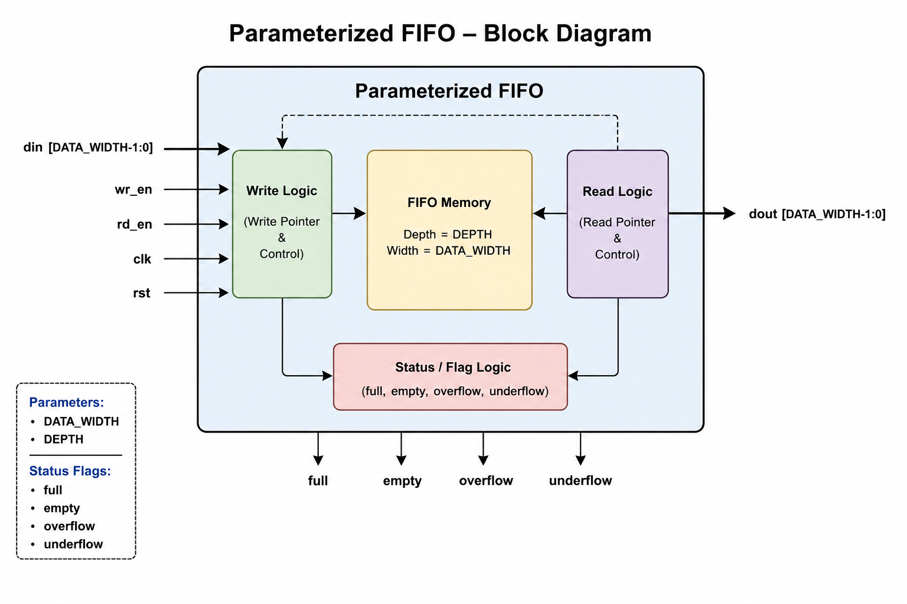

# Parameterized Synchronous FIFO (Verilog RTL)


---

## Overview

This project implements a **parameterized synchronous FIFO (First-In, First-Out)** in Verilog.

The FIFO is configurable in both **data width** and **memory depth**, making it reusable across different digital designs. It supports synchronous read/write operations, circular buffer implementation, status flag generation, and error detection through overflow and underflow flags.

The project was developed as part of my RTL Design & Verification learning roadmap.

---

## Features

- Parameterized DATA_WIDTH
- Parameterized DEPTH
- Circular buffer implementation
- Synchronous read/write
- Full flag
- Empty flag
- Overflow detection
- Underflow detection
- Simultaneous read/write support
- Industry-style RTL organization
- Comprehensive verification testbenches
- GTKWave waveform verification

---

## Block Diagram


<p align="center">
  
</p>

## Internal Architecture

The FIFO uses a circular buffer architecture.

<p align="center">
  
</p>

### Internal Components

| Component | Description |
|-----------|-------------|
| memory[] | Stores FIFO data |
| wr_ptr | Points to next write location |
| rd_ptr | Points to next read location |
| count | Tracks number of valid entries |
| full | Asserted when FIFO is full |
| empty | Asserted when FIFO is empty |
| overflow | Indicates illegal write attempt |
| underflow | Indicates illegal read attempt |

---

## Project Structure

```

FIFO/
│
├── rtl/
│   └── fifo.v
│
├── tb/
│   ├── fifo_tb.v
│   ├── fifo_tb_overflow.v
│   ├── fifo_tb_underflow.v
│   ├── fifo_tb_simultaneous.v
│   └── fifo_tb_wraparound.v
│
├── scripts/
│   ├── run_basic.bat
│   ├── run_overflow.bat
│   ├── run_underflow.bat
│   ├── run_simultaneous.bat
│   ├── run_wraparound.bat
│   ├── run_pilot.sh
│   └── score.py
│
├── formal/
│ ├── fifo_formal.sv
│ ├── pilotA_fpv.tcl
│ └── RESULTS.md
│
├── mutants/
│ ├── fifo_m1.v
│ ├── fifo_m2.v
│ ├── fifo_m3.v
│ ├── fifo_m4.v
│ ├── fifo_m5.v
│ └── make_mutants.py
│
├── ref/
│ ├── fifo_kill_check.v
│ └── fifo_ref_cov.sv
│
├── prompts/
│ ├── prompt_zero_shot.txt
│ └── prompt_one_shot.txt
│
├── docs/
│
├── README.md
├── LICENSE
└── .gitignore

```

---

## Parameters

| Parameter | Default | Description |
|-----------|---------|-------------|
| DATA_WIDTH | 8 | Width of each FIFO entry |
| DEPTH | 16 | Number of entries in FIFO |

---

## FIFO Interface

### Inputs

| Signal | Description |
|----------|-------------|
| clk | System clock |
| rst | Synchronous reset |
| wr_en | Write enable |
| rd_en | Read enable |
| din | Input data |

### Outputs

| Signal | Description |
|----------|-------------|
| dout | Output data |
| full | FIFO full flag |
| empty | FIFO empty flag |
| overflow | Illegal write detected |
| underflow | Illegal read detected |

---

## Verification

The FIFO has been verified using multiple directed testbenches.

| Test | Description | Status |
|------|-------------|:------:|
| Basic Read/Write | Verify FIFO ordering | done |
| Overflow | Verify writes to full FIFO | done |
| Underflow | Verify reads from empty FIFO | done |
| Simultaneous Read/Write | Verify concurrent operations | done |
| Pointer Wrap-around | Verify circular buffer | done |

### Formal verification and mutation analysis

Five properties written from the specification (full, empty, overflow, underflow, in-order data integrity) are proven unbounded in JasperGold on a 4-deep instance, and each of five hand-written mutants produces a counterexample. Two of the mutants (early write-pointer wrap, dropped data MSB) are caught only by the data-integrity property. Results and caveats: [`formal/RESULTS.md`](formal/RESULTS.md). Method and mutant list: [`docs/PILOT_A.md`](docs/PILOT_A.md).

The comparison with LLM-generated UVM testbenches is planned and not run yet.

---

## Simulation

Compile:

```bash
iverilog -o sim/fifo_basic rtl/fifo.v tb/fifo_basic_tb.v
```

Run:

```bash
vvp sim/fifo_basic
```

Open GTKWave:

```bash
gtkwave wave/fifo_basic.vcd
```

Or simply execute

```

scripts/run_basic.bat

```

---

## Example Waveforms

Check the wave sub folder.

## Design Decisions

### Circular Buffer

Instead of shifting memory after every read, the FIFO uses two pointers:

- Write Pointer (`wr_ptr`)
- Read Pointer (`rd_ptr`)

This allows all operations to complete in **O(1)** hardware complexity.

---

### Count Register

The FIFO occupancy is tracked using a count register.

```

count = writes − reads

```

Using the count register allows straightforward generation of:

- Full flag
- Empty flag

without comparing pointer values.

---

### Simultaneous Read/Write

When both `wr_en` and `rd_en` are asserted during the same clock cycle:

- Read operation succeeds
- Write operation succeeds
- Both pointers advance
- Count remains unchanged

This matches expected synchronous FIFO behavior.

---

## Tools Used

- Verilog HDL
- SystemVerilog (formal properties, functional covergroup)
- Icarus Verilog
- GTKWave
- JasperGold (formal property verification)
- Python (mutant generation and log scoring)
- Tcl (JasperGold automation)
- Visual Studio Code
- Git
- GitHub

---

## Future Improvements

- SVA assertions run in simulation (currently proven in formal only)
- LLM-generated UVM testbench comparison (prompts and runner staged in `prompts/` and `scripts/`; not run yet)
- Constrained-random UVM environment
- Asynchronous FIFO implementation
- Continuous integration (GitHub Actions)

---

## Takeaways

Through this project I gained practical experience with:

- RTL design of a parameterized synchronous FIFO
- Circular-buffer and pointer-based memory management
- Synchronous sequential logic
- Directed testbench development and waveform debugging (GTKWave)
- Writing a self-checking testbench against a reference model
- Formal property verification with JasperGold (bounded vs unbounded proof)
- Mutation analysis: building a labelled bug set and checking mutant non-equivalence

---

## Author

**Arnav Battu**

Electronics Engineering (VLSI Design)

Chaitanya Bharathi Institute of Technology (CBIT)

GitHub: https://github.com/zackkracky

